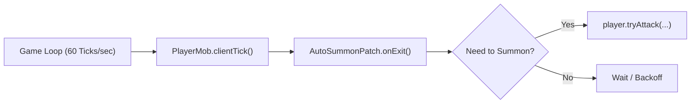
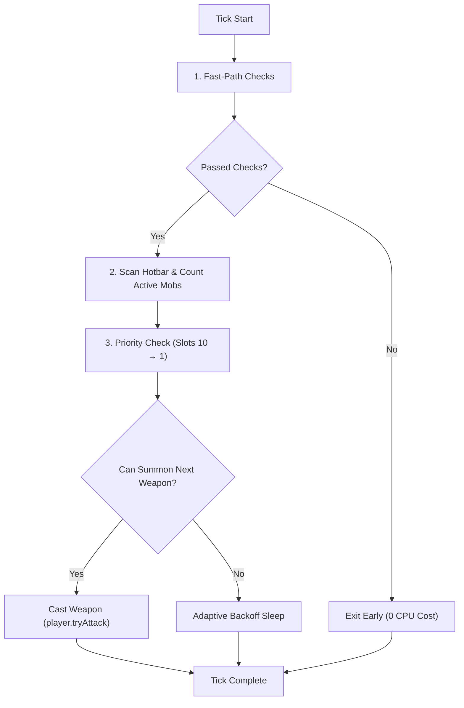
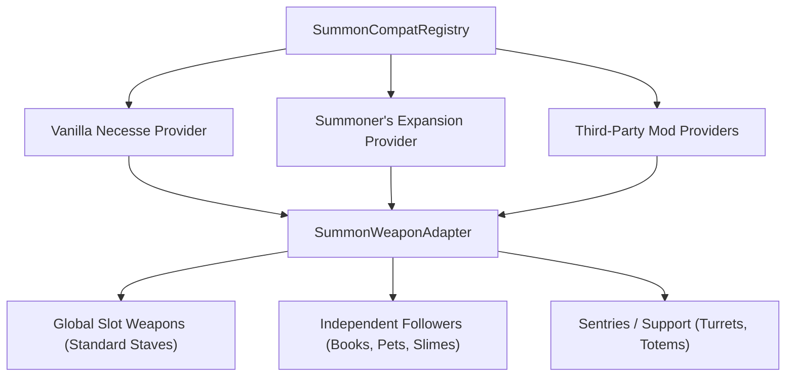

# Architecture & Technical Design

Welcome to the **Auto Summon** architecture guide! This document explains how the mod works under the hood in a beginner-friendly way, covering the game loop, minion tracking, compatibility system, and performance optimizations.

---

## 1. High-Level Overview

In Necesse, the game runs at **60 ticks per second** (60 FPS). Every tick, the game updates players, mobs, projectiles, and world state.

**Auto Summon** injects a small piece of code at the end of the local player's tick (`PlayerMob.clientTick()`). It checks what summon staves you are holding and automatically casts them if you are missing minions.



---

## 2. Project Structure

Here is a quick map of where everything lives in the codebase:

```text
src/main/java/autosummon/
├── AutoSummonMod.java          # Mod entry point (registers keybinds & compat providers)
├── AutoSummonConfig.java       # Configuration helper and runtime flags
├── AutoSummonModSettings.java  # Persistent settings (JSON saving & loading)
├── patches/
│   └── AutoSummonPatch.java    # Core game loop hook (PlayerMob.clientTick patch)
├── compat/
│   ├── SummonCompatRegistry.java          # Central registry for summon weapon adapters
│   ├── SummonWeaponAdapter.java           # Interface defining how weapons behave
│   ├── VanillaSummonCompatProvider.java   # Adapter provider for standard Necesse staves
│   ├── SummonerExpansionCompatProvider.java # Provider for Summoner's Expansion mod
│   └── MobClassifier.java                 # Fast O(1) filter for pets, mounts, & followers
├── gui/
│   ├── AutoSummonForm.java         # In-game configuration window (F9 menu)
│   └── AutoSummonGuiManager.java   # Opens and closes the GUI form
└── util/
    └── AutoSummonLog.java          # Rate-limited logger to prevent log spam
```

---

## 3. The Execution Lifecycle (Step-by-Step)

Every frame, `AutoSummonPatch.onExit()` runs through four clear phases:



### Phase 1: Fast-Path Safety Checks
Before doing any heavy work, the mod checks a series of conditions to exit immediately if summoning is not needed:
1. Is the mod enabled?
2. Is the player a valid local client player (not a server mob or another player)?
3. Is the player already attacking?
4. Is the mod currently on cooldown (e.g. just summoned 50ms ago)?
5. Did the player just switch worlds/levels (2.5s grace period to avoid transition lag)?

### Phase 2: Hotbar Scanning & Mob Counting
If checks pass, the mod inspects hotbar slots 1–10:
- Identifies any summon weapons in the hotbar using the **Compatibility Registry**.
- Scans all active mobs currently following the player in the level.
- Filters out non-combat followers (mounts, pets, and trinket ghosts) using `MobClassifier`.
- Tallies how many global summon slots are used and counts active minions for each staff.

### Phase 3: Priority Evaluation (Right-to-Left)
The mod loops through hotbar slots from **right to left (Slot 10 down to Slot 1)**:
- **Slot 10 has the highest priority** (cast first), descending to Slot 1.
- If a weapon's active count exceeds its configured limit (e.g. player lowered the limit in the GUI), the excess minions are safely dismissed.
- If the player has available summon slots and the weapon is ready, the player automatically casts the staff via `player.tryAttack(...)`.
- Once a weapon is summoned, the loop stops for that tick to allow the game to register the new mob.

### Phase 4: Adaptive Backoff
If all summon slots are already completely full:
- Instead of checking every single tick (which wastes CPU), the mod enters an **Adaptive Backoff**.
- It sleeps for **250ms**, increasing up to **1000ms** if the situation remains unchanged.
- If a minion dies, the player attacks, or the hotbar changes, the timer **instantly wakes up** to replace lost minions.

---

## 4. Minion Categories & Compatibility Layer

Not all summon weapons work the same way. Some take global summon slots, while others (like sentries or follower items) have their own independent caps.

The mod uses `SummonWeaponAdapter` to categorize any weapon:



### Weapon Categories:
1. **Global Slot Weapons** (e.g., *Skeleton Staff, Corrupt Eye*):
   - Share the player's main summon capacity (the summon buff counter).
   - Can cost 1 or more slots per minion.
2. **Independent Followers** (e.g., *Book of Bees, Magma Slime* from Summoner's Expansion):
   - Have their own separate maximum cap and do not consume your main summon slots.
3. **Sentries & Support** (e.g., *Stationary Turrets*):
   - Stationary summon structures with individual caps.

---

## 5. Performance: Why "Zero Allocations" Matter

In Java, creating new objects (`new ArrayList()`, `new Object()`, string concatenation `+`) puts objects on the **Heap Memory**. Periodically, Java runs the **Garbage Collector (GC)** to clean them up, which causes micro-stutters and frame drops.

Because `AutoSummonPatch` runs up to **60+ times every second**, we designed it to create **zero temporary objects during normal ticks**:

| Optimization | How It Works | Why It Helps |
| :--- | :--- | :--- |
| **Reused Array Structs** | `hotbarSlots` is a pre-allocated static array of `HotbarSlotInfo[10]` that gets cleared with `.reset()`. | No new objects created each tick. |
| **Fast Mob Lookup Cache** | `MobClassifier` caches mob classifications in pre-warmed lookup tables. | Avoids slow regex and string operations on every mob. |
| **Hotbar Fingerprinting** | Calculates a fast 64-bit hash of the hotbar items (`computeHotbarFingerprint`). | Detects hotbar changes in $O(1)$ time without scanning every tick. |
| **Adaptive Backoff** | Pauses checks for 250ms–1000ms when minion capacity is full. | Saves CPU cycles when you're just walking around with a full army. |

---

## 6. Safety & Crash Resilience

To make sure a mod never crashes your game or disconnects you from multiplayer:

1. **Top-Level Try-Catch Boundary**:
   - The main loop in `AutoSummonPatch.onExit()` is wrapped in a `Throwable` block.
   - If an unexpected error happens (e.g. another mod removes a mob mid-tick), the mod catches the error, sleeps for 3 seconds, and continues running smoothly without crashing the game.
2. **Rate-Limited Logging (`AutoSummonLog`)**:
   - Prevents error spam from freezing the game. Duplicate log messages are throttled to once every 5 seconds.
3. **Thread Safety**:
   - Settings are stored in `ConcurrentHashMap` so the GUI (running on the render thread) and the game tick (running on the client thread) can read and write limits simultaneously without errors.
4. **Client-Side Only**:
   - Mod runs 100% on your local game client without sending special custom packets. You can join vanilla multiplayer servers without requiring the server to install the mod.
